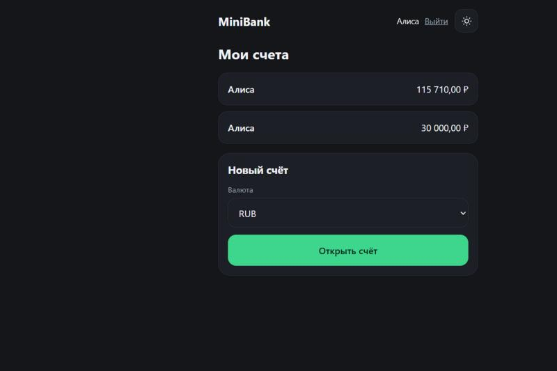
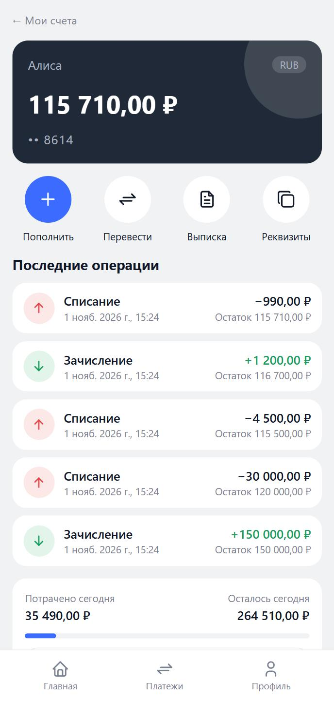
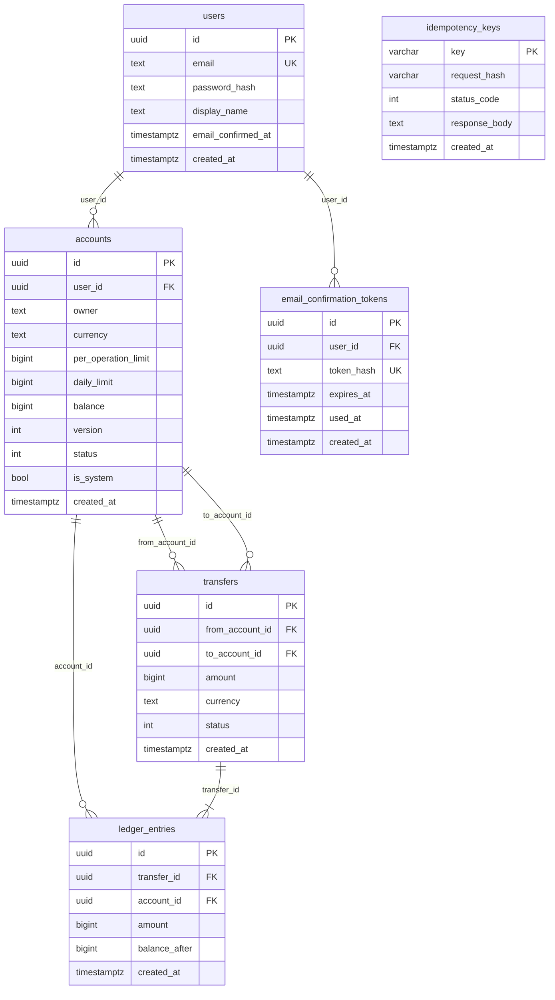
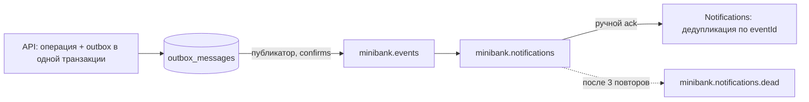
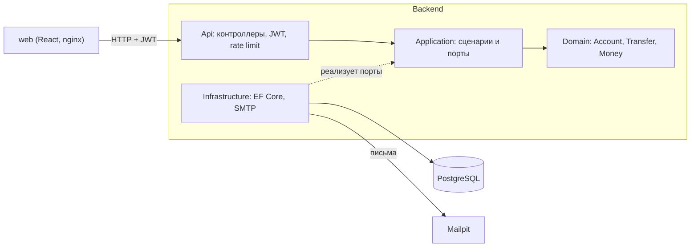

# MiniBank

[](https://github.com/Eksailed/MiniBank/actions/workflows/ci.yml)

Учебный банковский бэкенд на .NET: счета, переводы между ними, леджер с двойной записью, идемпотентность запросов и корректность при параллельных операциях.

Проект делается как портфолио для стажировки .NET-разработчика. Деньги в нём не настоящие.

## Стек

C#, ASP.NET Core (.NET 9), PostgreSQL 17, EF Core 9, Docker. Веб-клиент: React, TypeScript, Vite.

## Статус

Этапы 1–5 готовы. Реализация идёт этапами, каждый из которых заканчивается рабочим состоянием:

1. ✅ Ядро: счета, переводы, двойная запись, баланс из проводок.
2. ✅ Корректность: идемпотентность, защита от гонок и двойного списания.
3. ✅ Качество: тесты, Docker Compose, CI, документация.
4. ✅ Безопасность и функции: вход по email и паролю (JWT), подтверждение email, сброс пароля, владение счетами, лимиты, выписки с CSV.
5. ✅ События: outbox-паттерн, RabbitMQ и потребитель с дедупликацией.
6. Сервис уведомлений и Telegram-бот.

## Быстрый старт

Нужен только Docker.

```bash
docker compose up --build
```

Поднимется весь стек: PostgreSQL, RabbitMQ, API, потребитель событий, веб-клиент за nginx и Mailpit. Миграции применяются при старте API.

- Приложение: <http://localhost:8080>
- API и Swagger: <http://localhost:5050>, <http://localhost:5050/swagger> (порт открыт только на `127.0.0.1`)
- Почта (Mailpit): <http://localhost:8025>
- Очереди RabbitMQ: <http://localhost:15672> (логин `minibank`, пароль `minibank-local-only`; порт открыт только на `127.0.0.1`)

Настоящих писем стек не отправляет: Mailpit перехватывает всё, что шлёт API. Зарегистрируйтесь в приложении, откройте <http://localhost:8025>, найдите письмо «Подтвердите email в MiniBank» и перейдите по ссылке из него — после этого можно войти.

Остановка: `docker compose down`. Данные лежат в томе `minibank-data` и сохраняются между запусками; `docker compose down -v` их стирает. Порты 5432, 5050, 8025, 8080 и 15672 на хосте должны быть свободны.

Ключ подписи JWT в Compose — демонстрационный и публичный (только для локального запуска). Для любой другой среды задайте свой, не короче 32 байт: `JWT_KEY=... docker compose up`.

### Режим разработки

Нужны .NET SDK 9 и Node.js 22.22+ (или 24). В Compose поднимаются база и Mailpit, API и веб запускаются из исходников:

```bash
docker compose up -d postgres mailpit
dotnet run --project src/MiniBank.Api
```

В окружении Development миграции применяются при старте, Swagger включён, используются dev-ключ JWT (`development-only-signing-key-…` из `appsettings.Development.json`) и SMTP на `localhost:1025` (Mailpit); ссылка в письме ведёт на `http://localhost:5173` (Vite). Письма — в <http://localhost:8025>. Для запуска вне Development обязательны `Jwt__Key` (от 32 байт) и `Web__BaseUrl`. Веб-клиент — см. раздел «Web».

Тесты (интеграционные поднимают PostgreSQL через Testcontainers, нужен запущенный Docker):

```bash
dotnet test
```

## Web

Веб-клиент — React + TypeScript + Vite, лежит в `web/`. В Compose он уже запущен (<http://localhost:8080>); ниже — режим разработки с горячей перезагрузкой. Нужен Node.js 22.22+ (или 24).

```bash
cd web
npm install
npm run dev
```

Откройте <http://localhost:5173>. Клиент ходит в API на `localhost:5050` через прокси Vite (`/api` → API, префикс снимается), поэтому сначала запустите API (см. «Режим разработки»).

<p>
  
  
</p>

- Дизайн мобильный, в духе необанка: серый фон, белые карточки, тёмная карточка счёта, нижняя навигация («Главная», «Платежи», «Профиль»). Светлая и тёмная тема переключаются в профиле, выбор запоминается.
- Экраны: вход; регистрация из трёх шагов (форма с индикатором надёжности пароля, «Проверьте почту» с повторной отправкой не чаще раза в минуту, подтверждение по ссылке); «Забыли пароль» (запрос ссылки) и «Новый пароль» (по ссылке из письма); «Мои счета» (карточки счетов листаются свайпом, под ними «Пополнить», «Перевести», «Выписка» и сколько потрачено сегодня; новый счёт открывается нижним листом); «Платежи» (выбор счёта для перевода); «Профиль» (имя, email, тема, выход); счёт (баланс, лимиты, последние операции); пополнение, перевод, выписка с фильтром по датам и виду операций, подгрузкой страниц и скачиванием CSV.
- Список счетов приходит с сервера (`GET /accounts`), в браузере счета не хранятся. Токен входа лежит в `sessionStorage`: закрыли вкладку — вошли заново; ответ 401 разлогинивает.
- Лимиты счёта (на операцию и в сутки) редактируются в нижнем листе «Изменить лимиты» на странице счёта; там же видно, сколько потрачено и осталось сегодня.
- Каждая операция отправляется с `Idempotency-Key`: повтор после сбоя сети идёт с тем же ключом, правка суммы или получателя даёт новый.
- Типы запросов генерируются из Swagger работающего API: `npm run gen:api`.
- Тесты (Vitest, Testing Library, MSW; бэкенд не нужен): `npm test`. Сборка: `npm run build`.

## API

Всё, кроме `/auth/*` и `/health`, требует заголовок `Authorization: Bearer <токен>`; без него — 401.

| Метод и путь | Что делает | Успех |
| --- | --- | --- |
| `POST /auth/register` | Регистрация `{email, password, displayName}` (пароль 8–128 символов); на email уходит письмо со ссылкой | 202 |
| `POST /auth/confirm-email` | Подтвердить email `{token}` из ссылки в письме (токен живёт 24 часа) | 204 |
| `POST /auth/resend-confirmation` | Отправить письмо ещё раз `{email}`; всегда 202, ответ не выдаёт, есть ли такой email | 202 |
| `POST /auth/forgot-password` | Запросить письмо со ссылкой сброса `{email}`; всегда 202, ответ не выдаёт, есть ли такой email | 202 |
| `POST /auth/reset-password` | Задать новый пароль `{token, newPassword}` по ссылке из письма (токен живёт 1 час, одноразовый); недействительная ссылка или слабый пароль — 400 | 204 |
| `POST /auth/login` | Вход `{email, password}` → `{accessToken, expiresAt}`; только для подтверждённого email | 200 |
| `GET /me` | Профиль текущего пользователя | 200 |
| `GET /accounts` | Счета пользователя | 200 |
| `POST /accounts` | Открыть счёт `{currency}` (RUB, USD, EUR); не больше 50 счетов на пользователя | 201 |
| `GET /accounts/{id}` | Счёт и его баланс | 200 |
| `GET /accounts/{id}/limits` | Лимиты счёта, потрачено и осталось сегодня, потолки | 200 |
| `PUT /accounts/{id}/limits` | Изменить лимиты `{perOperation, daily}` (не больше потолка; дневной не меньше лимита на операцию) | 200 |
| `POST /accounts/{id}/deposit` | Пополнить с кассы `{amount, currency}`; нужен заголовок `Idempotency-Key` | 200 |
| `POST /transfers` | Перевод `{fromAccountId, toAccountId, amount, currency}` со своего счёта; нужен заголовок `Idempotency-Key` | 200 |
| `GET /accounts/{id}/entries?from&to&direction&page=1&pageSize=50` | Проводки счёта, новые первыми; фильтры — период и `direction=in\|out` | 200 |
| `GET /accounts/{id}/entries.csv?from&to&direction` | Выписка в CSV: UTF-8 с BOM, разделитель `;`, те же фильтры, без пагинации | 200 |
| `GET /health` | Проверка готовности: выполняет запрос к БД; не входит в Swagger | 200, при недоступной БД 503 |

Суммы в API задаются целым числом в минимальных единицах валюты (копейки, центы); в CSV — в основных единицах с точкой и двумя знаками. Ключ `Idempotency-Key` действует в пределах пользователя: чужой запрос с тем же ключом не пересекается с вашим. Даты в фильтрах — строго ISO 8601 (`yyyy-MM-dd` или с временем), без смещения считаются UTC; `from` включительно, `to` не включительно.

Swagger включён в окружении Development или при настройке `Swagger:Enabled=true` (переменная окружения `Swagger__Enabled`); по умолчанию выключен. В Compose включён; кнопка «Authorize» принимает токен из `POST /auth/login`.

```bash
curl -X POST http://localhost:5050/transfers   -H "Authorization: Bearer <токен>"   -H "Content-Type: application/json"   -H "Idempotency-Key: 7c9e6679-7425-40de-944b-e07fc1f90ae7"   -d '{"fromAccountId":"<id>","toAccountId":"<id>","amount":30000,"currency":"RUB"}'
```

Ошибки приходят как `ProblemDetails`; для части из них есть машинный код в поле `code`:

| Код | Когда |
| --- | --- |
| 400 | неверный ввод: валюта, сумма, пароль, email, лимиты, период и `direction` в выписке, перевод на тот же счёт, переполнение баланса; нет заголовка `Idempotency-Key` или он некорректен; `invalid_confirmation_token` — токен из письма неверный, просрочен или уже использован; CSV длиннее потолка строк (`Statements:MaxCsvRows`, по умолчанию 50 000) |
| 401 | нет или недействителен токен (в т.ч. токен валиден, но пользователь уже удалён — `GET /me`); `invalid_credentials` — неверный email или пароль |
| 403 | `email_not_confirmed` — пароль верный, но email ещё не подтверждён |
| 404 | счёт не найден или принадлежит другому пользователю (чужие счета неотличимы от несуществующих) |
| 409 | `email_taken` — email уже зарегистрирован; либо операция не прошла после нескольких автоматических повторов из-за гонки — запрос можно отправить заново с тем же ключом |
| 422 | недостаточно средств, счёт заблокирован, перевод с кассой или на кассу; `Idempotency-Key` уже использован с другим запросом; `account_limit_reached` — 50 счетов; `per_operation_limit_exceeded`, `daily_limit_exceeded` — превышен лимит счёта |
| 429 | слишком много запросов к `/auth/*` с одного адреса (по умолчанию 10 в минуту, `Auth:RateLimitPerMinute`) |

## Безопасность

- **Вход.** Пароль хранится как PBKDF2-хеш; вход по email и паролю выдаёт JWT (HS256, срок жизни `Jwt:LifetimeMinutes`, по умолчанию 60 минут). Ответ на неверный email и неверный пароль одинаковый, а время проверки не выдаёт, существует ли пользователь. Ключ `Jwt:Key` обязателен (от 32 байт), без него API не стартует.
- **Подтверждение email.** После регистрации войти нельзя, пока не открыта ссылка из письма. В БД хранится только SHA-256 от токена, токен одноразовый и живёт 24 часа; повторное письмо (не чаще раза в минуту) делает прежние токены недействительными. Письма уходят по SMTP (`Smtp:*`, в Compose — Mailpit), адрес веб-клиента для ссылки — `Web:BaseUrl`.
- **Владение счетами.** Каждый счёт принадлежит пользователю. Читать, пополнять и переводить можно только со своих счетов; чужой счёт отвечает 404. Переводить можно на любой существующий счёт по ID. Всё закрыто по умолчанию: анонимно доступны только `/auth/*` и `/health`.
- **Лимиты.** У счёта есть лимит на одну операцию и лимит в сутки (суммы списаний за календарные сутки UTC); значения по умолчанию и потолки зависят от валюты (`Limits:Default`, `Limits:Max`). Лимиты проверяются в той же транзакции, что и списание, поэтому параллельные запросы их не обходят. Пополнение лимитами не ограничено.
- **Лимит запросов.** `/auth/*` — не больше 10 запросов в минуту с одного адреса. Адрес клиента берётся из `X-Forwarded-For` только от доверенных прокси (`ForwardedHeaders:TrustedNetworks`, CIDR; в Compose — сеть Docker, где работает nginx). Без доверенных сетей заголовок игнорируется, иначе его подделка обходила бы лимит. По той же причине порт API в Compose опубликован только на `127.0.0.1`: наружу API отдаёт nginx.
- **Токен подтверждения email.** Ссылка из письма — `/confirm-email#token=…`: фрагмент не уходит на сервер, поэтому токен не попадает в логи nginx и в `Referer`; nginx дополнительно отдаёт `Referrer-Policy: no-referrer`.
- **Сброс пароля.** Токен из письма живёт 1 час и одноразовый, в базе хранится только его SHA-256; ссылка `/reset-password#token=…` несёт его во фрагменте, как и подтверждение email. Ответ на запрос письма не выдаёт, зарегистрирован ли адрес, а повторный запрос возможен не чаще раза в минуту. Сброс заодно подтверждает email: пользователь доказал, что владеет почтой. Прежние токены входа отзываются: в `users.password_changed_at` записывается время смены, а API сверяет с ним время выдачи токена (`iat`) — одна выборка пользователя по ключу на каждый защищённый запрос. Известная граница: `iat` хранится с точностью до секунды, поэтому токен, выданный в ту же секунду до смены пароля, не отзывается.
- **Выписки.** Период и направление операций фильтруются на сервере; CSV пишется потоком, а потолок строк проверяется до первого байта ответа.

## Как устроены деньги

- Сумма хранится как `bigint` в минимальных единицах, рядом код валюты. Один счёт — одна валюта.
- Каждый перевод — две проводки с суммой 0 в сумме: списание (минус) и зачисление (плюс). Пополнение — перевод с системного счёта «Касса» нужной валюты, поэтому сумма балансов всех счетов всегда равна нулю.
- `accounts.balance` — кэш суммы проводок. Баланс клиента не уходит ниже нуля (`CHECK`), кассы — могут.
- Проводки только добавляются: триггеры в БД запрещают `UPDATE`, `DELETE` и `TRUNCATE`.
- Одновременные изменения счёта разрешают пессимистичные блокировки (см. ниже); `accounts.version` остаётся страховкой.

## Идемпотентность и параллельность

**Идемпотентность.** `POST /transfers` и `POST /accounts/{id}/deposit` требуют заголовок `Idempotency-Key` (до 200 символов, без управляющих символов). Ключ резервируется в таблице `idempotency_keys` в той же транзакции, что и сама операция:

- повтор с тем же ключом и тем же запросом возвращает сохранённый ответ (200) с заголовком `Idempotent-Replayed: true`, деньги второй раз не двигаются;
- тот же ключ с другим запросом (другая сумма, счёт, операция) — 422;
- запрос, завершившийся ошибкой, ключ не занимает: после исправления причины его можно повторить с тем же ключом;
- параллельные запросы с одним ключом выстраиваются на уникальном индексе: выполняется один, остальные получают его ответ.

Ключ в запросе сравнивается по SHA-256 от нормализованного содержимого (валюта в верхнем регистре). TTL ключей не реализован: записи хранятся бессрочно.

**Параллельность.** Операция блокирует оба счёта одним запросом `SELECT ... WHERE id = ANY(...) ORDER BY id FOR UPDATE`: порядок блокировок всегда одинаковый, поэтому встречные переводы не создают взаимоблокировок. Если PostgreSQL всё же прервал транзакцию (SQLSTATE 40001 или 40P01), операция автоматически повторяется до 3 раз; после этого клиент получает 409.



## События

Перевод и пополнение пишут событие в таблицу `outbox_messages` в той же транзакции, что и сама операция. Фоновый публикатор в API забирает пачки строк (`SELECT … FOR UPDATE SKIP LOCKED`) и публикует их в обменник `minibank.events` (topic) с подтверждениями брокера. Потребитель `MiniBank.Notifications` читает очередь `minibank.notifications` и пишет полученное в свою схему `notifications` в той же базе `minibank`.



- События: `transfer.completed` и `account.deposited` (версия 1). В них только идентификаторы и суммы, без email, имён и токенов.
- Доставка at-least-once, повтор безопасен: потребитель отбрасывает дубль по `eventId`. Упавшая обработка повторяется до 3 раз, затем сообщение уходит в dead-letter очередь. Битый конверт попадает туда сразу, неизвестные тип и версия игнорируются.
- Ошибки публикации: повтор с растущей паузой (5 с, 10 с, … до 5 минут). Это про сбои конкретной строки: недоступность брокера попытки не тратит (пачка прерывается, строки ждут), так что долгий простой событий не теряет. После 10 неудачных попыток строка помечается `dead_at` и больше не отправляется. Недоступность БД у потребителя тоже не уводит сообщения в dead-letter: они возвращаются в очередь. Опубликованные строки удаляются через 7 дней.
- Недоступность брокера не влияет на `/health` и на сами операции: события копятся в outbox.
- Настройки: `Events:Enabled` (по умолчанию `true`; `false` отключает публикатор, но события всё равно пишутся), `Events:PollInterval`, `Events:BatchSize`, `Events:MaxAttempts`; `RabbitMq:Host`, `Port`, `User`, `Password`. В Compose логин и пароль брокера задаются через `RABBITMQ_USER` и `RABBITMQ_PASSWORD`.
- Посмотреть очереди и содержимое dead-letter очереди можно в панели <http://localhost:15672>.

## CI

Workflow [`.github/workflows/ci.yml`](.github/workflows/ci.yml) запускается на каждый push в `main` и на каждый pull request. Три независимых job-а:

- **backend** — `dotnet test` (интеграционные тесты поднимают PostgreSQL и RabbitMQ через Testcontainers);
- **web** — `npm ci`, тесты Vitest, `npm run build`;
- **stack** — `docker compose up -d --build --wait` собирает оба образа и поднимает стек, затем `scripts/smoke.sh` проходит весь сценарий через nginx: регистрация, письмо из Mailpit, подтверждение email, вход, два счёта, пополнение, перевод, выписка и CSV (BOM, заголовок, число строк), страница приложения и глубокие ссылки SPA, сброс пароля (письмо, новый пароль, отзыв прежнего токена входа), 401 без токена, доставку событий перевода до потребителя (очередь пуста, dead-letter пуста), а также то, что подделанный `X-Forwarded-For` не обходит лимит запросов. При падении job печатает `docker compose logs`.

Образы никуда не публикуются. То же, что делает job `stack`, запускается локально (повторный запуск смоука раньше чем через минуту упрётся в лимит запросов к `/auth`):

```bash
docker compose up -d --build --wait
bash scripts/smoke.sh
```

## Архитектура

Зависимости направлены внутрь: `Api` и `Infrastructure` знают о `Application`, `Application` — о `Domain`, а домен не зависит ни от чего. Инфраструктура подключается к приложению через порты (интерфейсы в `Application.Abstractions`), поэтому сценарии не знают ни про EF Core, ни про SMTP.



Запрос на перевод проходит так: контроллер берёт `userId` из токена → `TransfersService` проверяет владение счётом (чужой счёт неотличим от несуществующего) → `IdempotencyExecutor` в одной транзакции резервирует ключ, блокирует счета `SELECT … FOR UPDATE` в едином порядке, пишет перевод и две проводки и сохраняет ответ. Повтор с тем же ключом возвращает сохранённый ответ без повторного списания.

## Структура

```
src/MiniBank.Domain          сущности и правила: Account, Transfer, Money
src/MiniBank.Application     сценарии (AccountsService, TransfersService) и порты
src/MiniBank.Infrastructure  EF Core, миграции, репозитории
src/MiniBank.Api             контроллеры, обработка ошибок, Swagger, Dockerfile
src/MiniBank.Contracts       контракты событий (конверт, типы, JSON-настройки)
src/MiniBank.Messaging       настройки RabbitMQ и топология обменников и очередей
src/MiniBank.Notifications   потребитель событий: дедупликация, схема notifications, Dockerfile
web/                         веб-клиент: React + TypeScript + Vite, Dockerfile и nginx.conf
tests/                       юнит-, БД- и API-тесты
scripts/                     smoke.sh — сквозная проверка поднятого стека
.github/workflows/           CI
docker-compose.yml           весь стек: PostgreSQL + RabbitMQ + API + потребитель + веб + Mailpit
docs/                        спецификации, планы этапов, скриншоты для README
```
