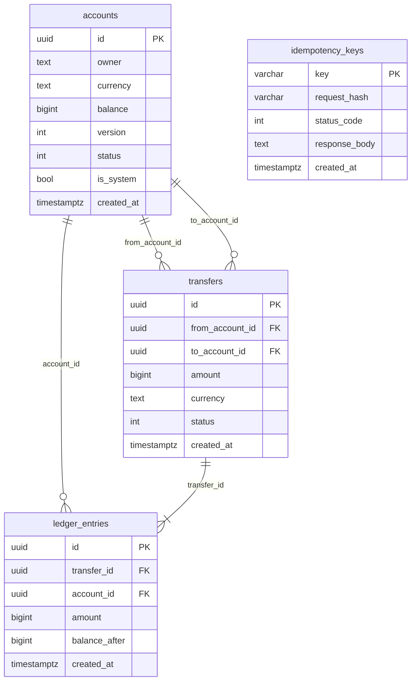

# MiniBank

Учебный банковский бэкенд на .NET: счета, переводы между ними, леджер с двойной записью, идемпотентность запросов и корректность при параллельных операциях.

Проект делается как портфолио для стажировки .NET-разработчика. Деньги в нём не настоящие.

## Стек

C#, ASP.NET Core (.NET 9), PostgreSQL 17, EF Core 9, Docker.

## Статус

Этапы 1 и 2 готовы. Реализация идёт этапами, каждый из которых заканчивается рабочим состоянием:

1. ✅ Ядро: счета, переводы, двойная запись, баланс из проводок.
2. ✅ Корректность: идемпотентность, защита от гонок и двойного списания.
3. Качество: тесты, Docker Compose, CI, документация.
4. Безопасность и функции: JWT, выписки, лимиты.
5. События: outbox-паттерн и брокер сообщений.
6. Сервис уведомлений и Telegram-бот.

## Быстрый старт

Нужны .NET SDK 9 и Docker.

```bash
docker compose up -d
dotnet run --project src/MiniBank.Api
```

В окружении Development миграции применяются при старте. Swagger: <http://localhost:5050/swagger>.

Тесты (интеграционные поднимают PostgreSQL через Testcontainers, нужен запущенный Docker):

```bash
dotnet test
```

## API

| Метод и путь | Что делает | Успех |
| --- | --- | --- |
| `POST /accounts` | Открыть счёт `{owner, currency}` (RUB, USD, EUR) | 201 |
| `GET /accounts/{id}` | Счёт и его баланс | 200 |
| `POST /accounts/{id}/deposit` | Пополнить с кассы `{amount, currency}`; нужен заголовок `Idempotency-Key` | 200 |
| `POST /transfers` | Перевод `{fromAccountId, toAccountId, amount, currency}`; нужен заголовок `Idempotency-Key` | 200 |
| `GET /accounts/{id}/entries?page=1&pageSize=50` | Проводки счёта, новые первыми | 200 |

Суммы задаются целым числом в минимальных единицах валюты (копейки, центы).

```bash
curl -X POST http://localhost:5050/transfers   -H "Content-Type: application/json"   -H "Idempotency-Key: 7c9e6679-7425-40de-944b-e07fc1f90ae7"   -d '{"fromAccountId":"<id>","toAccountId":"<id>","amount":30000,"currency":"RUB"}'
```

Ошибки приходят как `ProblemDetails`:

| Код | Когда |
| --- | --- |
| 400 | неверный ввод: валюта, сумма, пустой владелец, перевод на тот же счёт, переполнение баланса; нет заголовка `Idempotency-Key` или он некорректен (пустой, длиннее 200 символов, управляющие символы) |
| 404 | счёт не найден |
| 409 | редкий случай: операция не прошла после нескольких автоматических повторов из-за гонки; запрос можно отправить заново с тем же ключом |
| 422 | недостаточно средств, счёт заблокирован, перевод с кассой или на кассу; `Idempotency-Key` уже использован с другим запросом |

## Как устроены деньги

- Сумма хранится как `bigint` в минимальных единицах, рядом код валюты. Один счёт — одна валюта.
- Каждый перевод — две проводки с суммой 0 в сумме: списание (минус) и зачисление (плюс). Пополнение — перевод с системного счёта «Касса» нужной валюты, поэтому сумма балансов всех счетов всегда равна нулю.
- `accounts.balance` — кэш суммы проводок. Баланс клиента не уходит ниже нуля (`CHECK`), кассы — могут.
- Проводки только добавляются: триггеры в БД запрещают `UPDATE`, `DELETE` и `TRUNCATE`.
- Одновременные изменения счёта разрешают пессимистичные блокировки (см. ниже); `accounts.version` остаётся страховкой.

## Идемпотентность и параллельность

**Идемпотентность.** `POST /transfers` и `POST /accounts/{id}/deposit` требуют заголовок `Idempotency-Key` (до 200 символов, без управляющих символов). Ключ резервируется в таблице `idempotency_keys` в той же транзакции, что и сама операция:

- повтор с тем же ключом и тем же запросом возвращает сохранённый ответ (200) с заголовком `Idempotent-Replayed: true`, деньги второй раз не двигаются;
- тот же ключ с другим запросом (другая сумма, счёт, операция) — 422;
- запрос, завершившийся ошибкой, ключ не занимает: после исправления причины его можно повторить с тем же ключом;
- параллельные запросы с одним ключом выстраиваются на уникальном индексе: выполняется один, остальные получают его ответ.

Ключ в запросе сравнивается по SHA-256 от нормализованного содержимого (валюта в верхнем регистре). TTL ключей не реализован: записи хранятся бессрочно.

**Параллельность.** Операция блокирует оба счёта одним запросом `SELECT ... WHERE id = ANY(...) ORDER BY id FOR UPDATE`: порядок блокировок всегда одинаковый, поэтому встречные переводы не создают взаимоблокировок. Если PostgreSQL всё же прервал транзакцию (SQLSTATE 40001 или 40P01), операция автоматически повторяется до 3 раз; после этого клиент получает 409.



## Структура

```
src/MiniBank.Domain          сущности и правила: Account, Transfer, Money
src/MiniBank.Application     сценарии (AccountsService, TransfersService) и порты
src/MiniBank.Infrastructure  EF Core, миграции, репозитории
src/MiniBank.Api             контроллеры, обработка ошибок, Swagger
tests/                       юнит-, БД- и API-тесты
docs/                        спецификации и планы этапов
```
